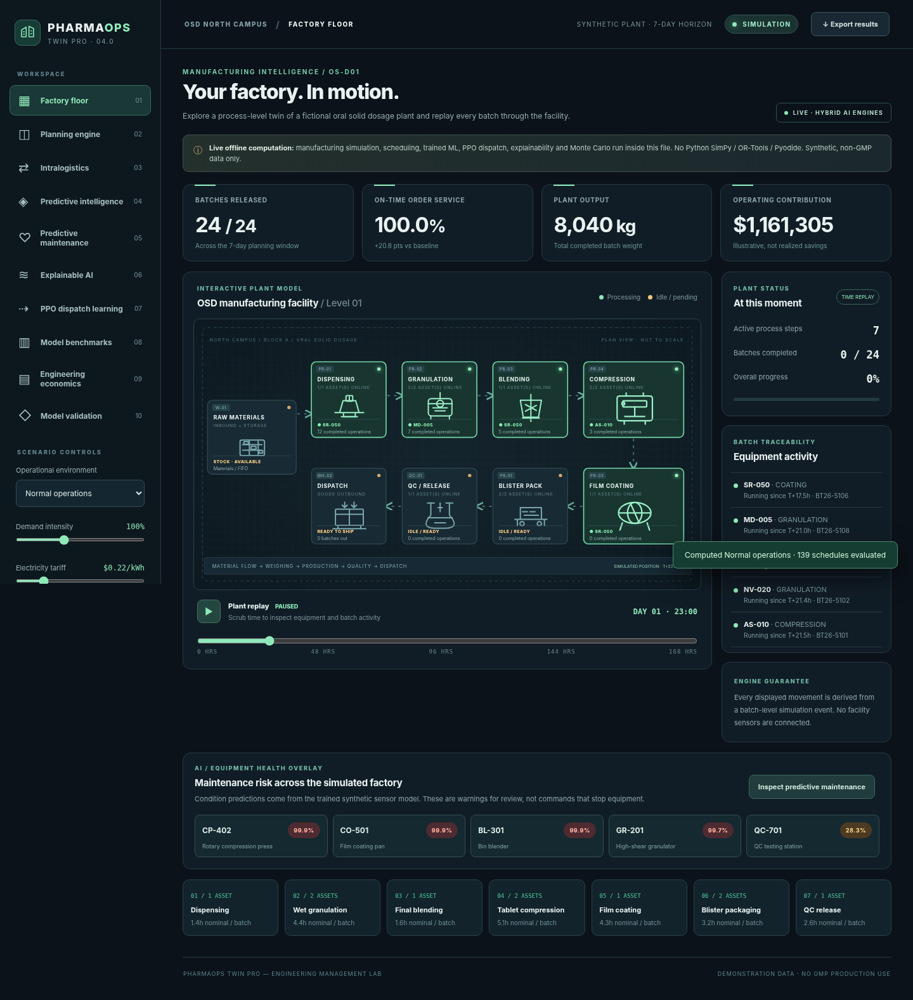

# PharmaOps - Pharma Manufacturing Digital Twin Prototype

PharmaOps is a browser-based **digital twin prototype** for a fictional oral solid dosage (OSD) facility. It combines event-driven manufacturing simulation, constraint-aware production scheduling, material-handling optimization, predictive maintenance, explainable machine learning, reinforcement learning, and engineering economics in an interactive factory model.

## Run the app

Access the app by clicking on the netlify deployment link provided above.

## Project Status

Research/portfolio prototype using synthetic data. It is *not* synchronized with a physical factory, is *not* a live production digital twin, and is *not* GMP/GxP validated. Predictions and recommendations must not be used for product quality, batch release, plant operation, or safety-critical decisions.



### What makes it a digital twin *prototype*?

The application has a virtual process model, identifiable manufacturing resources, a simulated plant clock, traceable equipment events, and decisions that change the modeled state. Its factory representation is **2D SVG, not 3D**; 3D visualization is not required for digital-twin research. What is missing for a true *connected* operational digital twin is ongoing synchronization with an identified physical plant (for example, via MES, SCADA, PLCs, and historians). All operating and sensor data shown here are synthetic.

## Walkthrough

The application contains ten workspaces:

| Workspace | What you can do |
|---|---|
| **01 · Factory floor** | Inspect a nine-zone OSD plant layout; replay simulated batch operations and equipment states over a 168-hour horizon. |
| **02 · Planning engine** | Compare baseline batch sequencing with a constraint-aware, cost-sensitive local-search schedule. |
| **03 · Intralogistics** | Inspect corridor routing, two shared transport vehicles, transfer events, congestion and waiting-time metrics. |
| **04 · Predictive intelligence** | Explore synthetic batch-duration and downtime models used to inform operational scenarios. |
| **05 · Predictive maintenance** | Inspect eight representative pieces of equipment; review sensor trends, 24-hour failure risk and predicted RUL; optionally score a local CSV. |
| **06 · Explainable AI** | Examine local and global feature contributions to maintenance-risk predictions. |
| **07 · PPO dispatch learning** | Compare a trained PPO material-dispatch policy with shortest-path and congestion-aware policies, then apply it to a new simulation. |
| **08 · Model benchmarks** | Compare classification and RUL regression models on held-out simulated equipment; review accuracy, calibration and inference timing. |
| **09 · Engineering economics** | Compare simulated operating contribution, cost categories, NPV and payback assumptions. |
| **10 · Model validation** | Review integrity checks, engine provenance and explicit limitations of the browser-native implementations. |

**Included scenario controls:** normal operations, demand surge, granulator outage, QC hold, supplier delay, and energy price spike. The demand slider ranges from 80–135% and the electricity tariff slider changes the simulated cost assumptions. The material-handling policy selector offers **Congestion-aware heuristic** and **Trained PPO dispatch**.

## Algorithms and engineering methods

### 1. Event-driven manufacturing simulation

**Facility:**, **Workload:**, **Resources:**, **Events:**, **Constraints:** 

This is a **custom JavaScript event simulator**. It is *not* the SimPy Python package.

### 2. Production scheduling and operations research

The planner constructs baseline sequences and alternative orders, evaluates them through the simulator and iteratively searches candidate schedules using swaps and insertion moves. It balances simulated contribution, service level and queue-time penalties while respecting the simulation's resource constraints.

This is **heuristic local search**, not exact mixed-integer/constraint programming. It does not provide global-optimality guarantees, solver bounds or CP-SAT optimality gaps. Google OR-Tools is also not used.

### 3. Intralogistics and reinforcement learning

The factory corridor network is represented as a weighted graph. Material moves are assigned to two tuggers and can use distance-based or traffic-aware routes. Transfers consume simulated time and affect downstream batch events.

The alternative learned dispatcher uses a browser-trained **Proximal Policy Optimization (PPO)** implementation with a clipped policy objective, a **linear categorical actor**, a value-function critic and generalized advantage estimation (GAE). Its four actions select one of two vehicles and one of two route policies. 

### 4. Predictive maintenance and supervised ML

Synthetic condition-monitoring features include vibration, bearing temperature, motor current, process pressure, equipment load, operating hours since service, and twelve-hour vibration/temperature slopes.

The application creates **2,016 synthetic equipment observations from 48 simulated asset identities**, with an asset-grouped split: **32 assets / 1,344 rows for training** and **16 different assets / 672 rows for testing**. Group separation prevents the same synthetic asset identity from appearing in both sets; it does not prove real-world generalization.

### 5. Explainable AI (XAI)

Risk explanations use **exact-subset Shapley attribution** over eight maintenance features (256 feature subsets). Absent features are replaced with a fixed training-set mean-feature reference. The explanation panel reports local contributions, global mean absolute contributions and a reconstruction check.

This is an independent Shapley implementation, **not** the official Python `shap` package or TreeExplainer.

### 6. Uncertainty, model benchmarking and economics

- **Monte Carlo:** paired stochastic manufacturing simulations compare baseline and optimized schedules under varying simulated realizations.
- **Classification metrics:** ROC-AUC, F1, precision, recall, Brier score, expected calibration error (ECE) and confusion matrix.
- **RUL regression metrics:** MAE, RMSE and R².
- **Timing:** browser-measured prediction wall time, normalized to milliseconds per 1,000 predictions.
- **Economics:** operating contribution, material/energy/labor/handling costs, lateness penalties, illustrative CapEx, support costs etc.

## Import and export

### Import - Optional maintenance CSV import.

### Exports - interface supports downloadable **simulation JSON**, benchmark/report JSON, and CSV outputs.

## Source structure and development

```text
PharmaOps_v4_Deliverable/
├── README.md                                      # This document
├── screenshots/                                  # Actual application captures
│   ├── PharmaOps_v4_Factory.png
│   ├── PharmaOps_v4_Maintenance.png
│   ├── PharmaOps_v4_Explainability.png
│   ├── PharmaOps_v4_PPO.png
│   ├── PharmaOps_v4_Benchmarks.png
│   └── PharmaOps_v4_Mobile.png
├── source/
│   ├── build_v4.py                                # Inlines CSS/JS into a single HTML
│   └── frontend/
│       ├── index.html
│       ├── style.css
│       ├── advanced_style.css
│       ├── browser_engine.js
│       ├── advanced_engine.js
│       ├── app_live.js
│       └── advanced_ui.js
├── tests/
│   ├── test_browser_engine.js
│   ├── test_v4_advanced.js
│   └── test_v4_browser.py
└── python_reference/                             # Separate optional Python reference; not run by HTML
    └── requirements.txt
```

### Current boundaries

- **Simulated, not live-connected:** no actual factory sensor streaming, digital-thread synchronization or closed-loop actuator control.
- **Simplified manufacturing model:** a stylized OSD workflow; not a validated equipment/process/cleaning or quality model.
- **Synthetic-only ML evidence:** no real failure history, verified labels or out-of-distribution performance assessment.
- **Heuristic scheduling:** no certified optimality bounds; no production-integrated OR-Tools execution.
- **Demonstration PPO:** performance and reward are defined in a synthetic dispatch environment; no safety guarantees or autonomous real-vehicle operation.
- **Risk attribution is model explanation:** not causality and not the official SHAP library.
- **GxP boundary:** no validated electronic records, audit trails, role controls, data integrity qualification, batch-release authority or regulatory clearance.
